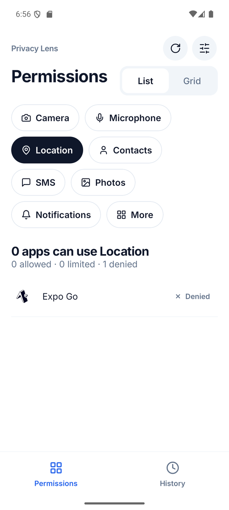
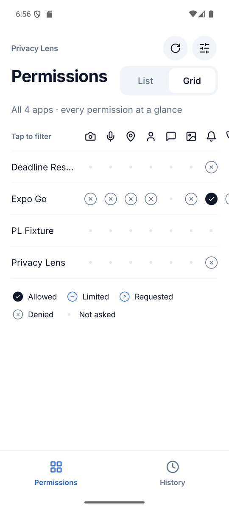
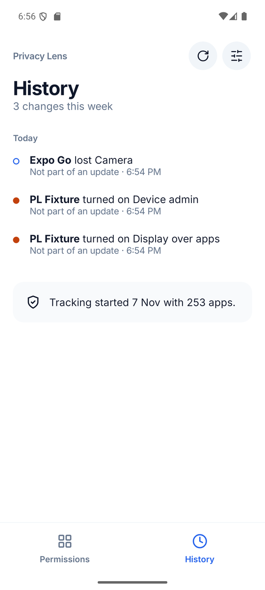
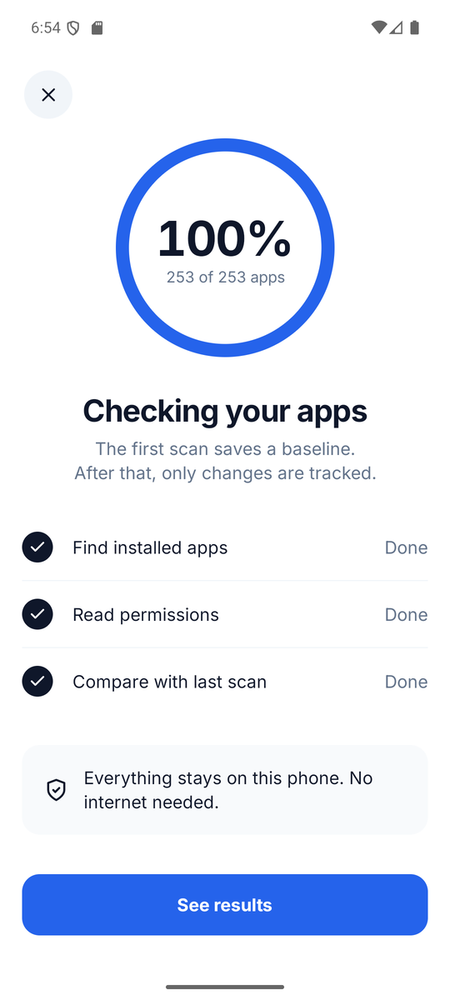
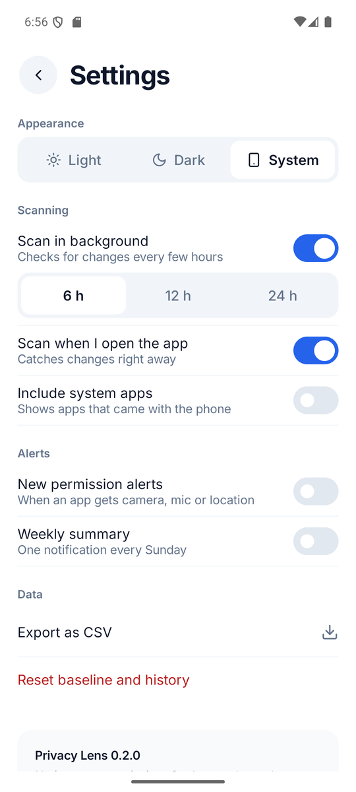
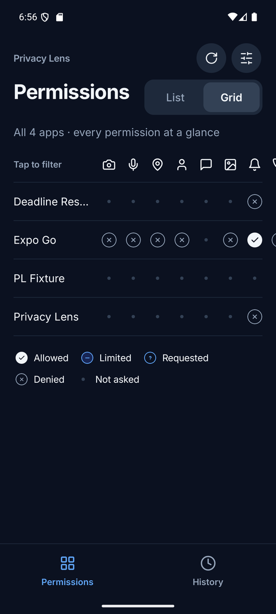
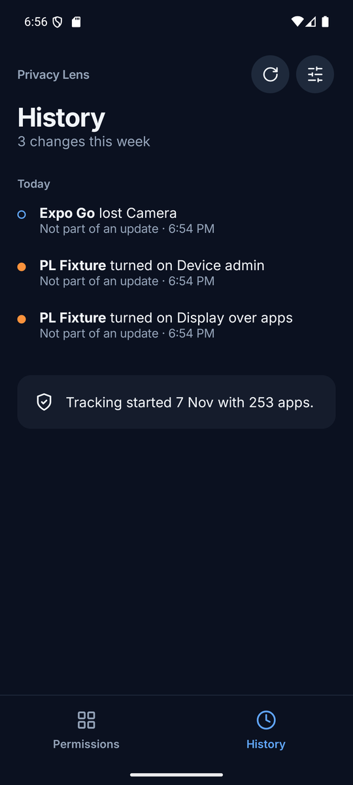
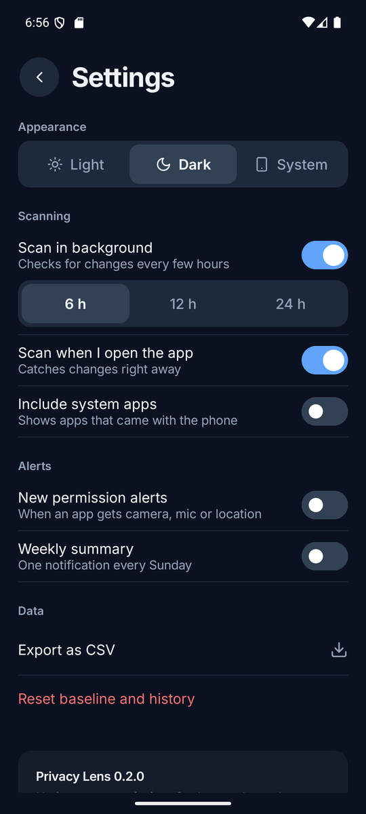

# Privacy Lens

An offline Android app that shows which apps can use your camera, microphone, location and more,
and keeps a history of every permission change. No account and no internet needed.

**[Download the APK](https://github.com/AshikaM07/Access-matrix-app/releases/latest)** · Built with Kotlin and Jetpack Compose

| Permissions | Grid | History | Scan | Settings |
|---|---|---|---|---|
|  |  |  |  |  |

| Dark theme | | |
|---|---|---|
|  |  |  |

Screenshots are from an Android 16 emulator.

## The problem

Android spreads permission settings across dozens of screens, one app at a time. It doesn't show
you which apps hold your location, and it says nothing when an update quietly adds a new permission.

## What it does

- **Permissions, two ways:** pick a permission and see every app that can use it, sorted Allowed →
  Limited → Denied. Or see every app × every permission at once in a grid.
- **Special access too:** accessibility services, device admins, display over other apps, usage
  access, notification access and installing other apps.
- **History:** "Wallpaper Daily got Location · After updating to 5.2". Every change is tagged as part
  of an update or not, so you can spot permissions that arrive quietly.
- **Alerts (optional):** a notification when an app gets camera, microphone or location, and a
  weekly summary on Sundays.
- **Export:** your permissions and history as CSV files, saved wherever you choose.
- **Light and dark themes**, large-text support up to 200 % and TalkBack labels on every cell.

## Install

1. Open the [latest release](https://github.com/AshikaM07/Access-matrix-app/releases/latest) on an Android phone.
2. Download `privacy-lens-0.2.1.apk` and open it.
3. Allow your browser to install apps if asked.
4. If Play Protect warns you, tap **More details > Install anyway**. It appears because the app isn't on the Play Store.

Needs Android 8 or newer. See the [release notes](release-notes-v0.2.1.md) for known limitations,
and [privacy](privacy.md) for how data is handled: it stays on your phone.

## Good to know

- **Some things Android keeps hidden.** For notification access and "install unknown apps", other
  apps can only see that an app *asks* for it, not whether it's turned on, so those show as
  **Requested**. On Android 10, the same applies to "display over other apps" and usage access.
  Notifications that an app has never been asked about also show as **Requested**: some phones,
  such as Samsung, still deliver them, and other apps can't tell.
- **No access log.** Android only lets system apps see *when* an app actually used the camera,
  microphone or location, so Privacy Lens shows who *can*, not who *did*.
- **Not on the Play Store.** Seeing every installed app needs a permission the Play Store limits.

## How it's built

| Layer | Technology |
|---|---|
| App | Kotlin, Jetpack Compose, Material 3, Navigation, Hilt |
| Local data | Room (with migrations), DataStore |
| Background | WorkManager (periodic rescans, weekly summary) |
| Testing | JUnit, Compose UI tests, instrumented tests on Android 10 and 16 emulators |
| Delivery | GitHub Actions; APK signed with a release key |

## Quality

- 95 JVM unit tests, 13 Python tests and 8 instrumented tests, all passing for this release
- The special-access readers are checked against real grants and revokes on Android 10 and Android 16
- Checked on an Android 16 emulator at 100 % and 200 % font size, in light and dark themes

v0.2.1 is released and still being improved.

## Licence

MIT. See [LICENSE](LICENSE).
